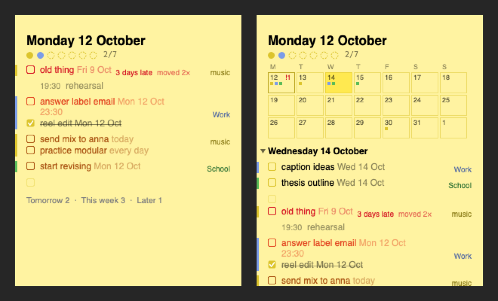

# Stickies+

A copy of Apple Stickies (same colors, 12 pt top bar, menus and shortcuts, taken from Stickies.app itself), plus checkboxes, a done pile on every note, dates that turn red, subtasks, and a day board that gathers today's tasks from every sticky.



How the code works: [docs/HOW-IT-WORKS.md](docs/HOW-IT-WORKS.md). The day board's design: [docs/DAY-BOARD.md](docs/DAY-BOARD.md).

## Download

Get `Stickies+-1.0.zip` from [Releases](../../releases), unzip it and drag Stickies+ into Applications. It needs macOS 15 or later and runs on Apple Silicon and Intel Macs.

The app isn't notarized by Apple, so the first time you open it macOS says it can't check it for malware. Click Done, then open System Settings › Privacy & Security, scroll down and click Open Anyway next to Stickies+. After that it opens normally.

## Using it

- **⇧⌘L** (Edit › Checklist) turns the current line(s) into checkboxes. Again turns them back.
- **Click a box** to tick it. The line gets crossed out and slowly fades. **13 hours later** it leaves the note and goes to that note's done pile, with the date and time you ticked it. Untick before then and it stays.
- **Return** on a checkbox line makes the next box. Return on an empty box ends the list. Backspace at the start of a line removes its box.
- **⇧⌘D**, or the **✓** in the top bar, flips the note over to its done pile. Right-click an item there to put it back on the note, remove it, or clear the pile.
- **Dates:** write one at the end of a task: `today`, `tomorrow`, `fri`, `next week`, `16 oct`, `16.10.`, `fri 15:00`, `zítra`, `pátek`. It shows small and gray, and becomes a fixed date ("Fri 16 Oct") when you leave the line. Retype it to move the task. Repeating: `every day`, `every mon`, `každý den`.
- **Getting red:** your day ends at 2:00. A task due today turns orange, then red, from 20:00. A task with a time does that over the 6 hours before it. Late tasks stay red and show "2 days late", plus "moved 3×" if you keep pushing them.
- **Subtasks:** Tab indents a line under the one above, Shift-Tab takes it back. The parent shows "1/3" and ticks itself when all its subtasks are done.
- **Folding:** hover a line with lines under it and click the ▸ to fold them away.
- **Ticking** strikes the line through in a few choppy steps and pops a little pixel sparkle.
- **Sorting:** dated tasks sort themselves inside each block of a sticky (earliest first, undated ones after, headings stay put, subtasks move with their parent) when you leave the line.
- **Day board (⇧⌘B):** the date as its title, a punch card of today's tasks (each finished one punched in its sticky's color), late tasks on top, then calendar events, then each sticky's tasks as a group with a thin bar in its color and its name on the right. Click a sticky's name to fold its group. Tomorrow, This week and Later sit in one line at the bottom; click one to open it. Editing or ticking a task on the board changes it in its own sticky. Type a new task in an empty line there and it goes to your "random pile" sticky, or to a sticky named with `#name`.
- **Calendar:** click the small calendar button in the board's top bar, the date title, or Window › Show Calendar for three weeks from this Monday, with a mark per task in its sticky's color. Click a day to list its tasks under the calendar; a task typed there gets that day.
- **Mornings:** at 8:00, or the first time your Mac is awake after that, the board comes to the front once.
- **Menu bar:** a checklist icon with the number of tasks left today, red when something is late. Click it to bring the board forward.
- **Open at Login** is on by default (Stickies+ menu). Calendar events need a one-time permission. Click Allow when macOS asks.
- **Colors:** Stickies' six on ⌘1–⌘6, plus White, Silver, Slate, Graphite (⌘7–⌘0) and Charcoal in the Color menu. Graphite and Charcoal show black text as light text. The text itself stays black, so switching back to a light color looks normal.
- The scroller is a thin bar in the note's own color that shows while you scroll, like Stickies. It never turns into a white bar, even with a mouse plugged in.
- Everything else works like Stickies: ⌘1–⌘6 colors, ⌘M collapse (or double-click the top bar), ⇧⌘M zoom to fit, ⌥⌘F float on top, ⌥⌘T translucent, Window › Arrange By, Import/Export Text, fonts, images.

## First launch

Stickies+ copies your Stickies notes, keeping their position, size, color and float setting. Stickies itself isn't touched. macOS may ask whether Stickies+ can access data from other apps. Allow it. If you missed that prompt, use File › Import from Stickies….

Running both apps at once shows every note twice, so quit Stickies once you've moved over.

## Build from source

Needs Xcode (for Swift and the macOS SDK).

```bash
./scripts/install.sh          # builds and installs /Applications/Stickies+.app (an old copy goes to the Trash)
./scripts/build.sh            # just builds build/Stickies+.app
./scripts/release.sh          # Apple Silicon + Intel build, zipped for sharing
swift test                    # 67 tests: checklists, dates, red, subtasks, folding, typing, board, saving, import
RENDER_DIR=/tmp swift test --filter RenderBoardPreview   # draws board.png
swift scripts/make_icon.swift # redraws Resources/AppIcon.icns
```

`build.sh` signs with your Apple Development certificate if you have one (so macOS keeps the calendar permission across builds), otherwise ad-hoc.

## Where notes live

`~/Library/Application Support/Stickies+/Notes/<id>/`

- `content.rtfd`: the note text (opens in TextEdit)
- `note.json`: color, position, checkboxes, done pile

Closing a note (⌘W) deletes it. If it has text, Stickies+ asks first, and the note goes to the Trash.

## Testing knobs

```bash
defaults write com.matteoruggiero.stickiesplus DoneDelaySeconds 30    # 30 s instead of 13 h
defaults delete com.matteoruggiero.stickiesplus DoneDelaySeconds      # back to 13 h
```

Launch arguments `-DataDir <folder>` and `-AppleStickiesDir <folder>` point the app at test copies.

## Not copied from Stickies

- File › Export All to Notes…
- Find searches the current note only (Stickies can search all notes).
